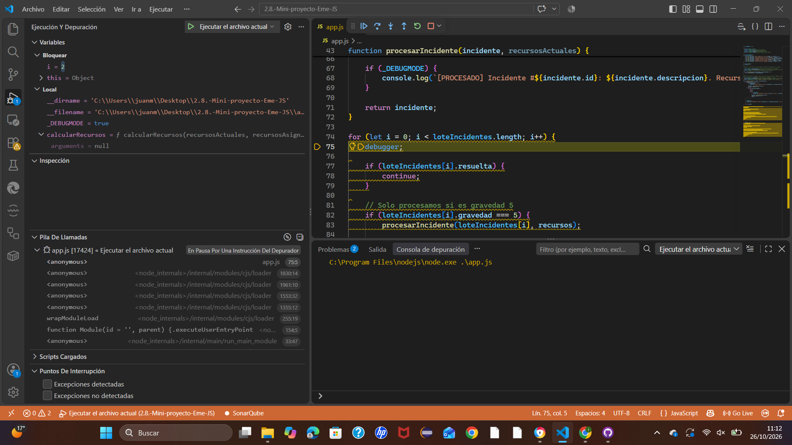
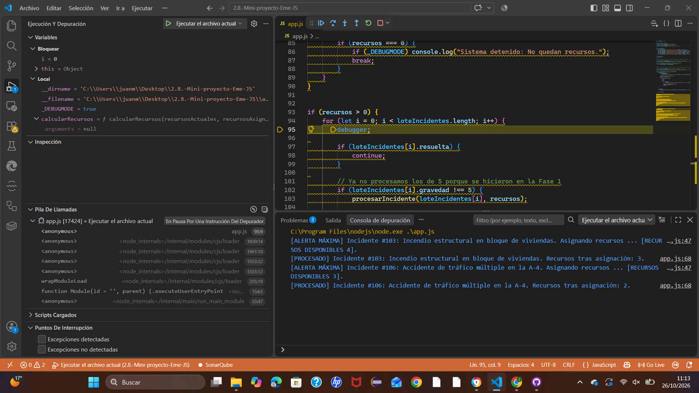
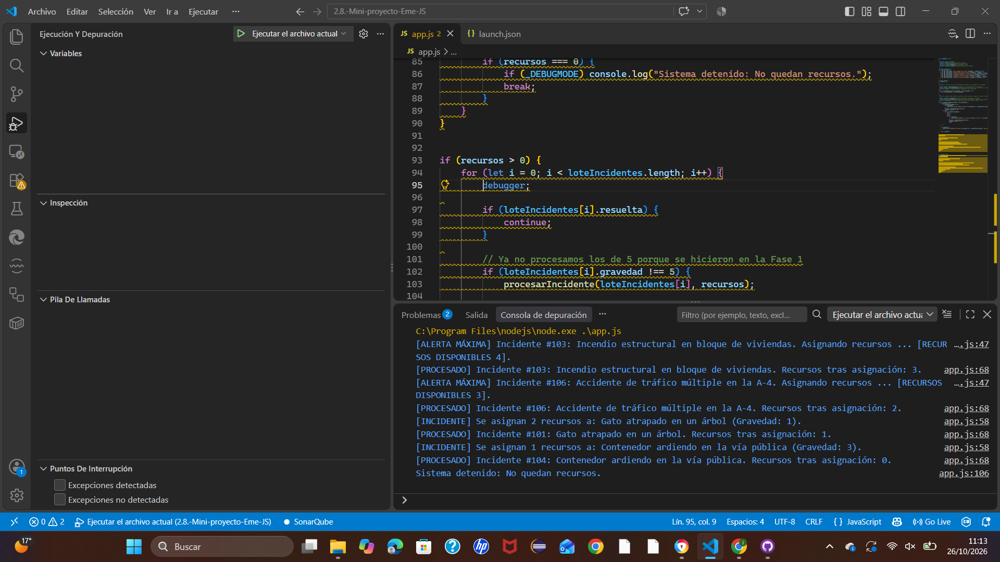
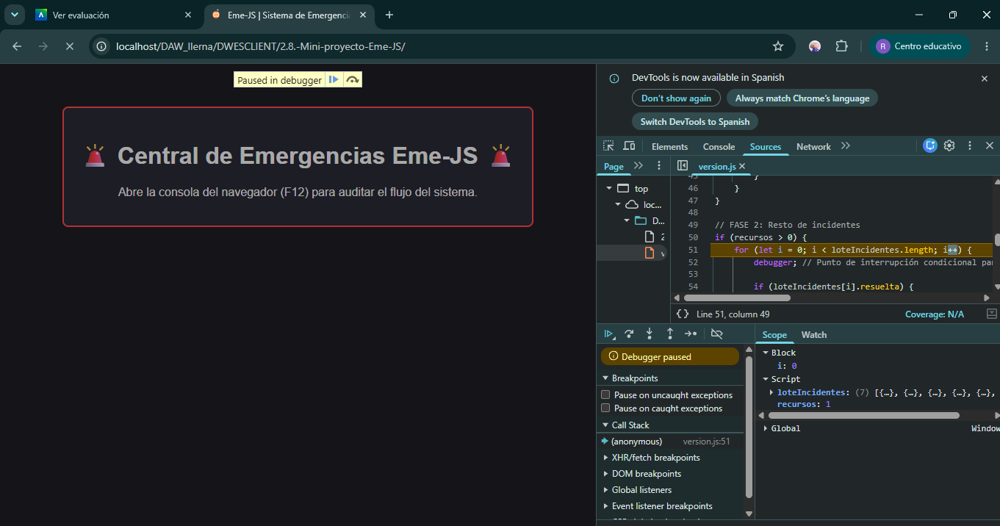

# 📔 Diario de Depuración y Co-Evaluación - Eme-JS
 

Experiencia Juanma
Mi experiencia ha sido buena, al principio hemos planteado como íbamos a estructurar el código, nos hemos puesto a hacerlo y nos hemos ayudado mutuamente. Parte de que haya sido buena la experiencia es la persona que estaba haciendolo conmigo, Rafa, ha sido muy paciente conmigo.

Experiencia Rafael
Como experiencia puedo decir que me ha gustado el proyecto, considero que tiene bastantes puntos a tratar del temario que estamos dando y que con anteriores actividades habiamos ya tratado algunos me ha gustado trabajar con mi compañero ya que se ha involucrado totalmente en el proyecto y no ha procrastinado hemos trabajado en clase muy bien. Lo mas complicado yo diría que ha sido utilizar el debugger que es cierto que no lo hemos visto muy a fondo por lo demás me gusto todo.
